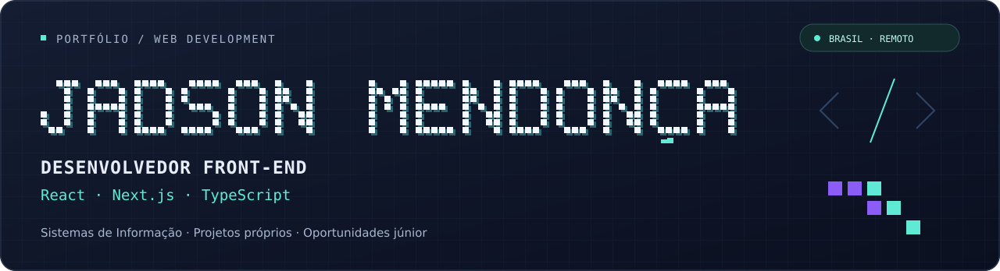

  

  <a href="https://www.linkedin.com/in/jadson-mendonca/">LinkedIn</a> &nbsp;·&nbsp;
  <a href="mailto:dinho_mendonca@icloud.com">E-mail</a> &nbsp;·&nbsp;
  <a href="https://visiteminhaloja.online/loja/loja-ai-demonstracao">Demonstração do Loja AI</a>

# Olá, sou o Jadson

**Desenvolvedor Front-end Júnior · React · Next.js · TypeScript**

Sou bacharel em **Sistemas de Informação pela Estácio** e curso **Técnico em Desenvolvimento de Sistemas no SENAI**. Desenvolvo projetos próprios de aplicações web com interfaces responsivas, integração de APIs e persistência de dados.

Minha experiência como desenhista contribui para o cuidado com composição visual e apresentação das interfaces. Busco oportunidades **remotas no Brasil** como **Front-end Developer Júnior**, com interesse também em posições Full Stack Júnior compatíveis com minha prática.

## Tecnologias que utilizo nos projetos

| Área | Tecnologias |
| :--- | :--- |
| Interfaces | React.js, Next.js, TypeScript, JavaScript, HTML, CSS e Tailwind CSS |
| Integrações e dados | Route Handlers do Next.js, APIs HTTP/REST, Supabase e PostgreSQL |
| IA e automação | Ollama, Qwen, Python, Faster Whisper e WhatsApp Cloud API |
| Versionamento | Git e GitHub |

## Projetos em destaque

### 01 · Loja AI

**Loja online e cardápio digital para pequenos negócios.**

Reúne o gerenciamento de produtos e uma vitrine para o cliente consultar o catálogo, montar o carrinho e preencher os dados do pedido.

- Painel administrativo, cadastro de produtos e configuração da loja.
- Autenticação, persistência e armazenamento de imagens com Supabase.
- Catálogo com categorias, carrinho e fluxo de checkout.
- Verificações manuais de navegação e ajustes de contraste e legibilidade.

**Stack:** React · Next.js · TypeScript · Tailwind CSS · Supabase

[**Abrir demonstração →**](https://visiteminhaloja.online/loja/loja-ai-demonstracao) &nbsp; [Código e documentação](https://github.com/dinhomendonca-spa/cardapio-ai)

### 02 · Atende AI

**Assistente comercial com IA local e integração ao WhatsApp.**

Centraliza leads e histórico de conversas para apoiar o atendimento de pequenos negócios com a assistente Lia.

- Painel de leads, conversas e configurações comerciais.
- Integração com WhatsApp Cloud API e persistência no Supabase/PostgreSQL.
- Respostas com Ollama/Qwen e transcrição de áudio com Python/Faster Whisper.
- Monitoramento do atendimento em tempo real com Server-Sent Events (SSE).

**Stack:** React · Next.js · TypeScript · Supabase · Python · Ollama

**Demonstração atual:** execução local. O repositório descreve a instalação, o funcionamento e as melhorias planejadas.

[**Explorar código e documentação →**](https://github.com/dinhomendonca-spa/atende-ai)

## Formação e contato

- **Bacharelado em Sistemas de Informação** — Estácio, concluído em 2019.
- **Técnico em Desenvolvimento de Sistemas** — SENAI, em andamento.
- **São Pedro da Aldeia, RJ** — disponibilidade para trabalho remoto no Brasil.
- **Contato:** [dinho_mendonca@icloud.com](mailto:dinho_mendonca@icloud.com) · [LinkedIn](https://www.linkedin.com/in/jadson-mendonca/)
